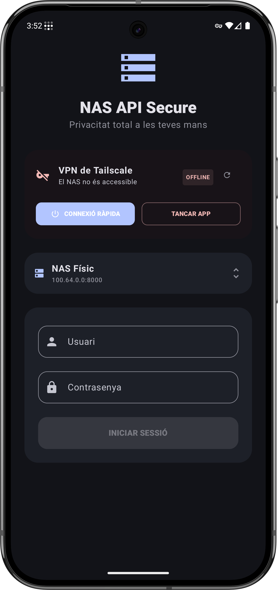
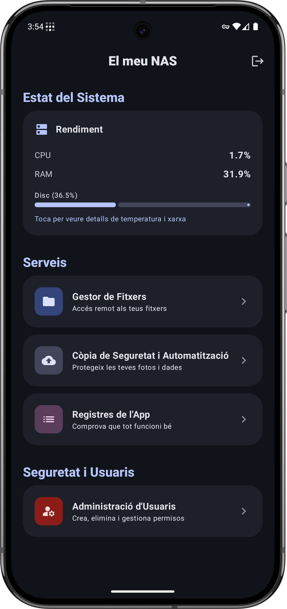
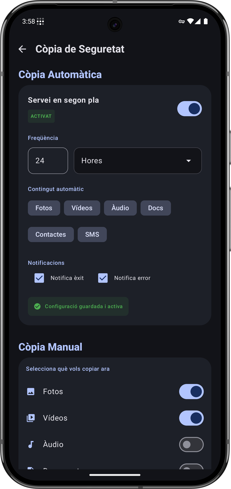
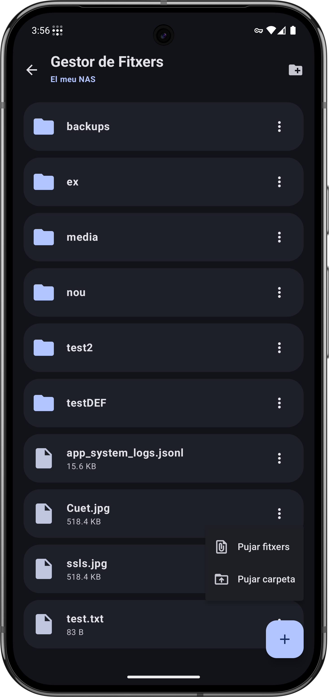

# NAS domèstic per a còpies de seguretat automàtiques des d'Android

Treball de Fi de Grau d'Enginyeria Informàtica, Escola d'Enginyeria, Universitat Autònoma de Barcelona (UAB), juny de 2026.
**Autor:** Nil Gascón

Sistema format per un **NAS domèstic de baix cost** i una **aplicació Android** que fa còpies de seguretat automàtiques del mòbil (fotos, vídeos, àudio, documents, contactes i SMS). És una alternativa privada als serveis d'emmagatzematge al núvol comercials: les dades no surten mai de casa.

<p align="center">
  
  
  
  
</p>

## Arquitectura

```
┌──────────────────────┐        Tailscale (VPN mesh, WireGuard)        ┌───────────────────────────┐
│  App Android         │  ───────────────  HTTPS + JWT  ─────────────▶ │  Servidor NAS (Debian)    │
│  Kotlin · Compose    │                                               │  API REST FastAPI         │
│  WorkManager         │                                               │  SQLite (usuaris)         │
└──────────────────────┘                                               │  ZFS RAIDZ2 (6 × 1 TB)    │
                                                                       └───────────────────────────┘
```

Diagrama complet: [`docs/diagrama-arquitectura.pdf`](docs/diagrama-arquitectura.pdf)

| Part | Tecnologies |
|---|---|
| **App Android** (`app/`) | Kotlin, Jetpack Compose (Material 3), MVVM, Retrofit + OkHttp, WorkManager, Navigation Compose |
| **Servidor** (`server/`) | Python, FastAPI, Uvicorn, Peewee (SQLite), JWT (PyJWT), bcrypt, psutil |
| **Infraestructura** | Debian minimal, ZFS amb RAIDZ2, Tailscale, servei systemd |

## Funcionalitats

- **Configuració inicial** (*setup*) i creació del compte d'administrador des de l'app
- **Còpies de seguretat automàtiques** periòdiques en segon pla, també després de reiniciar el mòbil
- **Gestor de fitxers**: navegar, pujar, descarregar (les carpetes es descarreguen en .zip), crear carpetes i esborrar
- **Gestió d'usuaris** amb rols (admin / usuari)
- **Estat del sistema**: disc, CPU per nucli, RAM, swap i temperatures
- **Test de rendiment** de la connexió (latència, velocitat de baixada i de pujada)
- **Registre del sistema**: els logs de l'app s'envien al NAS i es poden consultar
- **Diversos NAS** guardats, amb canvi ràpid entre ells

## Estructura del repositori

```
.
├── app/                 # Aplicació Android (mòdul Gradle)
├── gradle/ …            # Wrapper i catàleg de versions de Gradle
├── server/
│   ├── main.py          # API REST (FastAPI)
│   ├── tests/           # Proves automàtiques (pytest)
│   ├── requirements.txt
│   └── .env.example     # Plantilla de configuració
├── docs/                # Diagrama d'arquitectura i captures de pantalla
└── LICENSE
```

## Posar-ho en marxa

### Servidor

```bash
cd server
python3 -m venv .venv
source .venv/bin/activate
pip install -r requirements.txt
cp .env.example .env      # i edita'l: com a mínim NAS_STORAGE_PATH
python main.py            # escolta per HTTPS al port 8000
```

La primera vegada que s'executa, el servidor genera un certificat TLS autosignat (`cert.pem` / `key.pem`), la base de dades `nas_users.db` i, si no n'has definit cap, una clau aleatòria per signar els tokens. Cap d'aquests fitxers s'ha de pujar al repositori (ja són al `.gitignore`).

Per executar les proves:

```bash
pip install -r requirements-dev.txt
pytest
```

Per accedir-hi des de fora de casa, instal·la [Tailscale](https://tailscale.com/) al servidor i al mòbil, i fes servir la IP de Tailscale del NAS a l'app.

### App Android

1. Obre l'arrel del repositori amb **Android Studio**.
2. Deixa que Gradle sincronitzi les dependències.
3. Executa la configuració `app` en un dispositiu o emulador (Android 10 / API 29 o superior).
4. Afegeix el teu NAS (IP i port 8000) i fes el *setup* inicial. Abans del setup s'entra amb `admin` / `admin`, i durant el setup es crea el compte d'administrador definitiu.

També pots instal·lar directament l'APK publicat a [Releases](../../releases).

## Seguretat

- Contrasenyes guardades amb bcrypt; sessions amb tokens JWT que caduquen.
- Totes les rutes de fitxers es validen perquè no puguin sortir de `NAS_STORAGE_PATH`.
- Permisos per rol: tots els usuaris poden fer còpies de seguretat (crear carpetes i pujar fitxers), però llistar, descarregar, canviar el nom o esborrar fitxers i gestionar usuaris és només per a administradors.
- L'accés provisional `admin` / `admin` deixa de funcionar quan s'ha completat el setup.

### Limitacions conegudes

És un prototip acadèmic pensat per a una xarxa domèstica de confiança. L'app accepta el certificat autosignat del servidor sense validar-lo, així que la seguretat del canal depèn del túnel xifrat de Tailscale. Una millora futura seria fixar el certificat del NAS a l'app (*certificate pinning*).

## Llicència

Copyright © 2026 Nil Gascón

Aquest projecte és programari lliure: el pots redistribuir i modificar sota els termes de la [GNU General Public License v3.0](LICENSE) (GPL-3.0). Qualsevol versió modificada que es distribueixi també ha de ser de codi obert sota la mateixa llicència.
